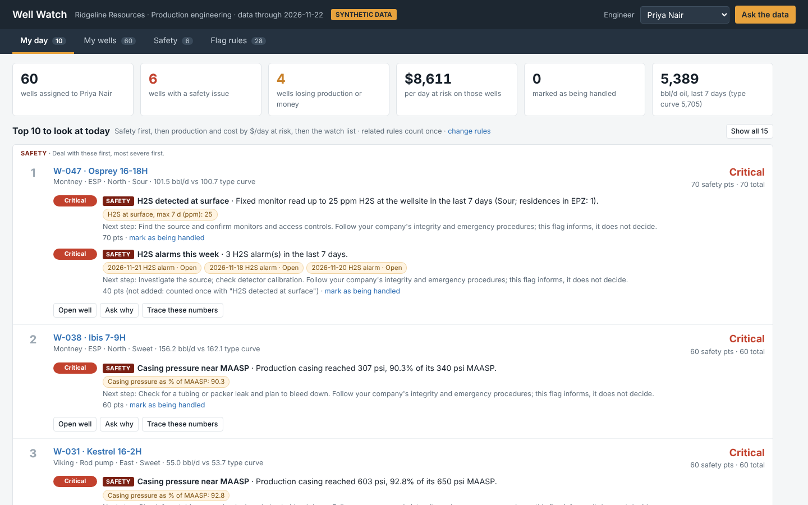
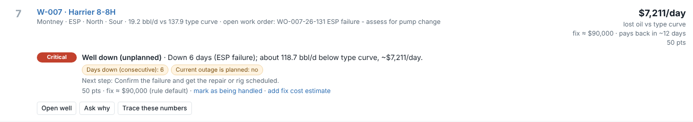
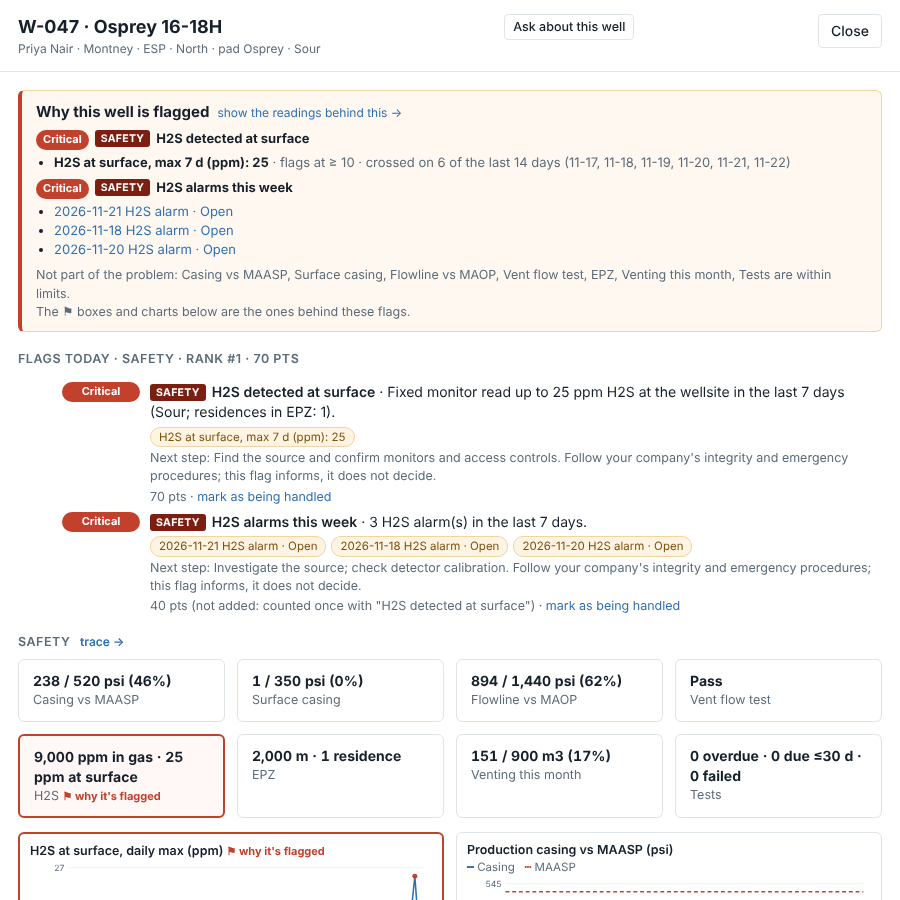
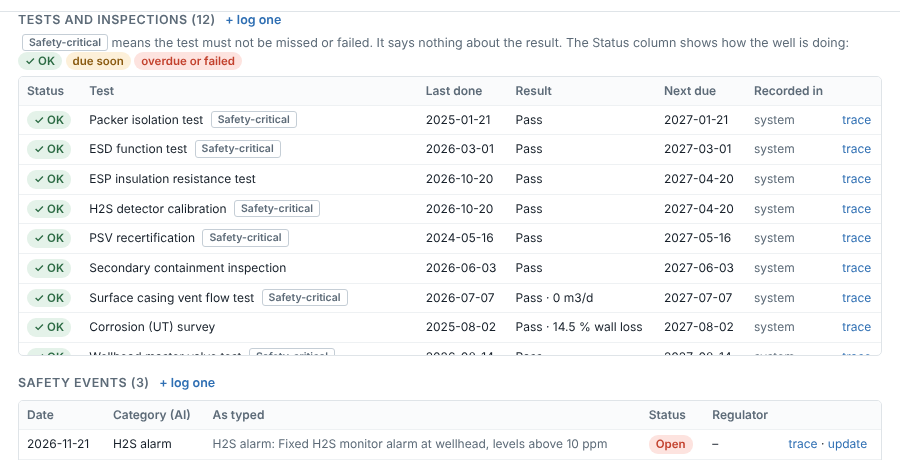
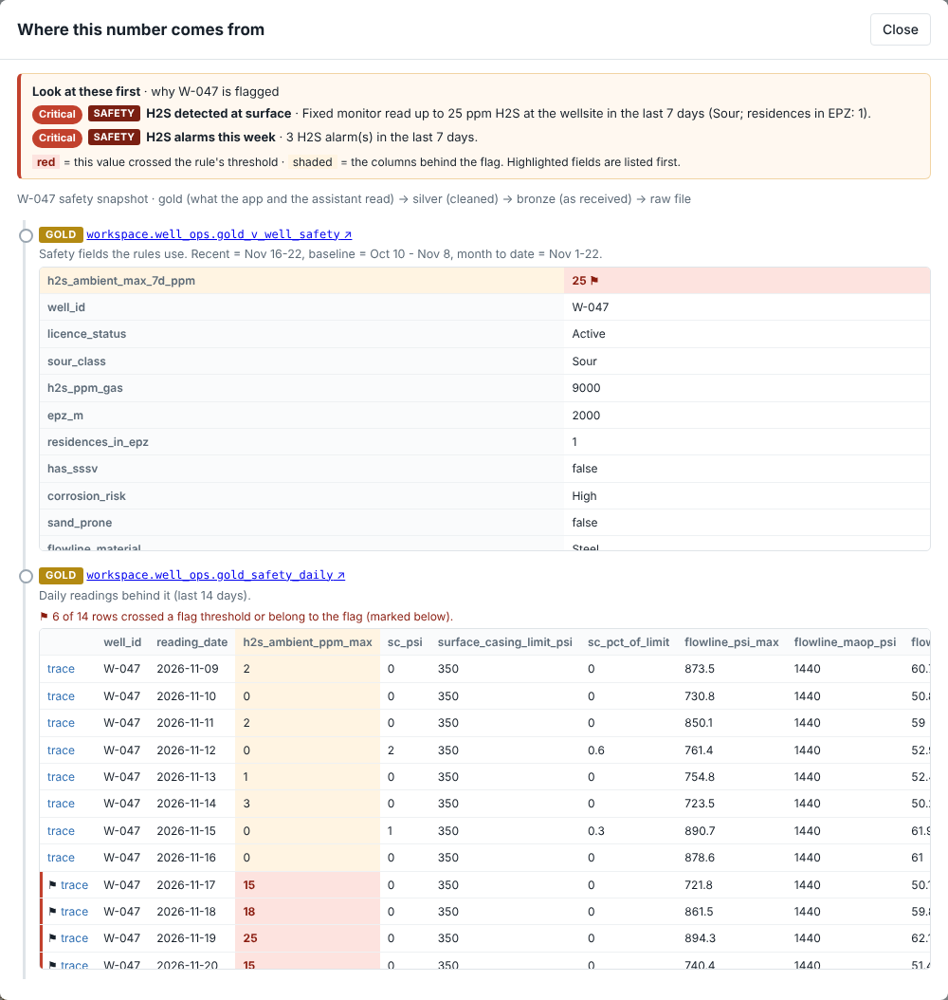
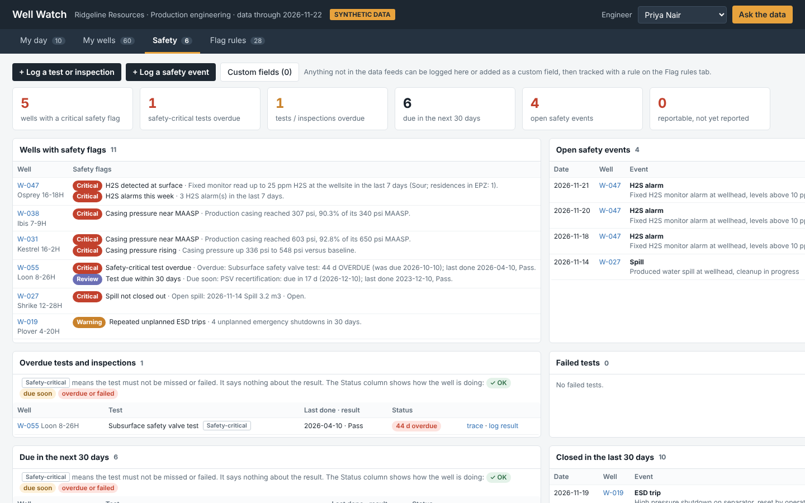
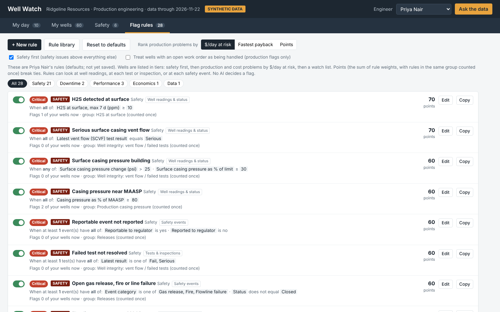
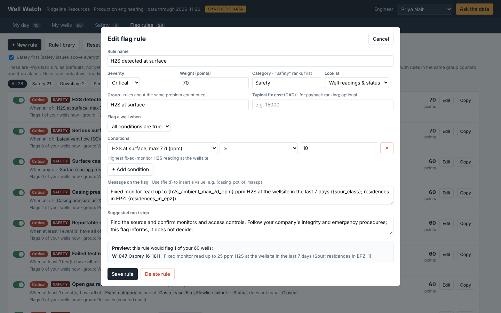
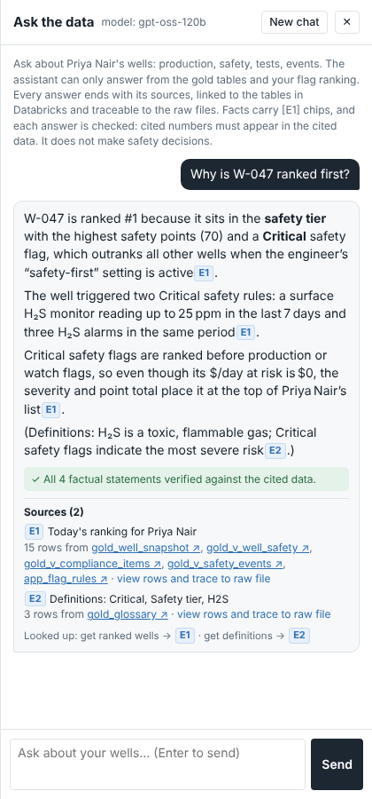

# Well Watch user guide

This guide is for anyone using Well Watch, including people with no oil and gas background. It covers what the app is for, how to read each screen, and what the colours and terms mean.

> **All data in this app is synthetic.** It contains 200 made-up wells, 4 made-up engineers, and problems planted on purpose for testing. No real company data is used.

---

## What Well Watch is for

A **production engineer** looks after a group of oil wells, often 50 to several hundred. Every day each well sends readings: how much oil it produced, pressures, whether the pump ran, gas detector levels, test results, incidents. Nobody can read all of that every morning, so problems get missed until they are expensive or dangerous.

Well Watch reads it all and answers one question: **which wells do I need to look at today, and why?**

- It **flags** problems with rules the engineer controls. No AI decides what is a problem.
- It **ranks** the flagged wells. Safety comes first, then the wells losing the most money.
- It **explains** each flag with the actual numbers, and every number can be traced back to the original data file.
- It has an **assistant** that answers questions in plain English and always shows where its answer came from.

---

## Getting in

Open the app link in your browser and sign in with your Databricks account. You need permission to use the app; ask whoever set it up.

**If you see "App Not Available":** the app was paused while nobody was using it (the free Databricks workspace does this). In Databricks, go to **Compute → Apps → well-watch**, click **Start**, wait a minute or two, then reload the link. If you are giving a demo, open the app a few minutes beforehand.

---

## Your morning in five minutes

1. **Pick your name** in the *Engineer* menu (top right).
2. Open **My day**. The top 10 wells to look at are listed, most urgent first.
3. **Read each card.** It says what is wrong, gives the numbers, and suggests a next step.
4. **Click a well** to see its page. The box at the top says exactly why it is flagged.
5. **Not sure about a number?** Click **trace** to see where it came from.
6. **Already dealing with something?** Click **mark as being handled** so it leaves your list until it is fixed, or until it gets worse.
7. **Have a question?** Click **Ask the data** and type it.

---

## The screen at a glance

| Part | What it does |
|---|---|
| **Engineer menu** (top right) | Switches between engineers. Each sees their own wells, rules and settings. |
| **Ask the data** (top right) | Opens the chat assistant on the right side. |
| **My day** | Today's ranked list of wells that need attention. |
| **My wells** | Every well you look after in one sortable table. |
| **Safety** | Overdue and failed tests, open incidents, and forms to log new ones. |
| **Flag rules** | The rules that decide what gets flagged, and how the list is ranked. |

The numbers next to each tab are counts. For example, *Safety 6* means 6 wells have a safety issue.

---

## My day

### The summary boxes along the top

These show how many wells you have, how many have a safety issue, how many are losing production or money and how much per day, how many are marked as being handled, and total oil produced versus expected.

### The list is in sections

| Section | What's in it | Order |
|---|---|---|
| **Safety** | Wells with a Critical or Warning safety problem | Most severe first |
| **Production and cost** | Wells losing oil or money | By dollars per day lost (you can change this) |
| **Watch list** | Minor items, such as a test coming due | By points |
| **Being handled** | Wells someone has marked as being dealt with | Shown below the list, not in the top 10 |

Safety always comes first. A gas leak matters more than a well losing $7,000 a day. You can turn this off in *Flag rules*, but it is on by default.

### Reading a well card

- **Number on the left:** the well's rank.
- **Well name and details:** ID, name, the rock formation it produces from, pump type, area, and oil produced versus expected (the "type curve").
- **Right side:** for production problems, **$ per day** lost, a rough **fix cost**, how many days until the fix **pays for itself**, and the well's **points**. For safety problems, the severity.
- **Each flag:**
  - the coloured severity tag;
  - the rule's name, in bold;
  - a sentence with the actual numbers;
  - small chips showing the values that triggered it;
  - a suggested next step.
- **Links under each flag:**
  - **mark as being handled:** takes it off your list until a date you choose. It comes back sooner if it gets more than 10% worse than when you marked it, or if a new related record appears (for example, another alarm). Safety flags need a note on who is handling it.
  - **add fix cost estimate:** enter what you think the fix will cost. This improves the payback ranking.
- **Buttons:**
  - **Open well:** opens the well page.
  - **Ask why:** sends the question to the assistant.
  - **Trace these numbers:** shows where the numbers came from.

### What points mean

Each rule is worth some points (its "weight"). A well's points are the total of the rules it trips. Rules about the same underlying problem are counted only once. For example, "casing pressure near its limit" and "casing pressure rising" are really one problem, and the card says "(not added: counted once with…)". Points only break ties within a section; they are not dollars or probabilities.

---

## A well's page

Click any well name to open its page.

### "Why this well is flagged" (top box)

This is the most important part of the page. For each problem it shows:
- the **measured value** and the **limit** that triggers the flag, e.g. *H2S at surface: 25 ppm · flags at ≥ 10*;
- **which recent days** crossed the limit;
- for test or incident flags, the **records involved**, as links;
- a line saying what is **not** part of the problem, e.g. *casing, flowline, tests are within limits*.

A green box means nothing is flagged.

### Boxes and charts

The **Safety** and **Production** sections show the well's key numbers as boxes and charts. Anything behind a flag has a **red border** and a **⚑ why it's flagged** label, and those charts are moved to the front.

On the charts:
- **solid blue line:** the reading;
- **dashed red line:** the hard limit (e.g. the maximum safe pressure);
- **dotted line:** where your rule flags it;
- **red dots:** readings past the flag line.

Hover to see a value. Click any point to trace it to the raw file.

### Tests and inspections

- **Status** is the column to read: **✓ OK** (green), **Due in N d** (amber), **N d overdue** or **✗ Failed** (red). Problems are listed first.
- **Safety-critical** (grey label) means the test must not be missed or failed. **It says nothing about the result.** A safety-critical test that passed is good.
- **Recorded in:** "system" means the test came from the company's compliance system; otherwise it shows who logged it in the app.
- **+ log one:** record a test that was just done.

### Safety events

These are incidents such as emergency shutdowns, gas alarms, spills, releases and regulator findings. Open ones show a red **Open** tag. Click **update** to close one or record that it was reported to the regulator.

---

## Tracing a number back to its source

Click **trace** anywhere: on a card, a box, a chart point, a table row, or an assistant source.

- **"Look at these first"** (top): why the well is flagged.
- **Red cells:** values that crossed the rule's limit. In the picture, the gas readings of 15, 18 and 25 ppm on the days the alarms went off.
- **Shaded columns:** the other data behind the flag. These are moved next to the well and date columns so you don't have to scroll.
- **The steps**, from top to bottom, follow the data back to where it came from:
  - **Gold:** the finished data the app and the assistant read.
  - **Silver:** the cleaned data, with the cleaning rules that were applied (for example, duplicate readings removed, kPa converted to psi, sensor error codes removed).
  - **Bronze:** the data exactly as it arrived.
  - **Raw file:** the name of the original file.
- **↗ links** open the table in Databricks.

---

## Safety tab

This tab gathers the safety picture across all your wells:
- wells with safety flags;
- open safety events;
- overdue tests;
- failed tests;
- tests due in the next 30 days;
- events closed in the last 30 days.

**Buttons at the top:**
- **+ Log a test or inspection:** pick a well and a test type, or type a new type. Enter the date, result and how often it is required. The list and flags update straight away.
- **+ Log a safety event:** pick a category, or type a new one. Enter the date, whether it is open, the volume, and whether it is reportable to and reported to the regulator.
- **Custom fields:** add your own per-well value, such as "Annulus B limit (psi)" or "Near a school (yes/no)". Then fill it in for each well. It appears in the rule editor, so you can flag on it.

Between these three, anything you need to track can be tracked, even if the data feeds don't include it.

---

## Flag rules

The rules decide what gets flagged. Each engineer has their own set, starting from 28 starter rules: 21 for safety, 7 for production, cost and data quality.

**Ranking settings** (top):
- **Rank production problems by:**
  - **$/day at risk** (default);
  - **Fastest payback:** cost to fix ÷ $/day;
  - **Points.**
- **Safety first:** puts safety problems above everything else. On by default.
- **Treat wells with an open work order as being handled:** off by default, because a work order often only means "assess", not "fixing".

**Buttons:**
- **+ New rule:** create a rule.
- **Rule library:** add back any starter rule you removed.
- **Reset to defaults:** go back to the starter rules.
- **Copy:** start a new rule from an existing one.
- **Switch** (left of each rule): turn a rule on or off.

### Editing a rule

| Setting | Meaning |
|---|---|
| **Severity** | **Critical**: act today. **Warning**: a real problem, building or not yet dangerous. **Review**: nothing wrong yet, a heads-up. |
| **Weight (points)** | How much this rule adds to a well's points. |
| **Category** | Use **Safety** for safety rules; they go in the Safety section. |
| **Look at** | What the rule checks. **Well readings & status**: the well's numbers. **Tests & inspections**: each test record. **Safety events**: each incident. |
| **At least this many match** | For tests and events only. For example, "3 or more emergency shutdowns in 30 days". |
| **Group** | Rules about the same problem; only the highest weight counts. |
| **Typical fix cost** | Used for payback ranking. The starter costs are rough placeholders; replace them with your own. |
| **Conditions** | Pick a field, a comparison and a value. Text under each field explains what it means. |
| **Message / Next step** | The text shown on the flag. Type `{field_name}` to insert a value. |

The **Preview** at the bottom shows which of your wells the rule would flag before you save it.

---

## Ask the data (the assistant)

Type a question in plain English. Good examples:
- "What should I look at first today?"
- "Are there any safety issues on my wells?"
- "Why is W-047 ranked first?"
- "How has W-015 produced over the last 10 days compared with its type curve?"
- "Which of my tests are overdue?"
- "What does MAASP mean?"
- "Which production problems pay back fastest?"

**How to trust an answer:**
- **[E1], [E2] chips** after each fact: click one to see the exact query and rows it came from.
- **Green ✓ "All statements verified":** every number cited was checked against the data.
- **Amber ⚠ with highlighted text:** a number could not be matched to the data, usually because the assistant did its own arithmetic. Check it before relying on it.
- **Sources** (bottom of every answer): the tables the answer used, with **↗** links to Databricks and **view rows and trace to raw file**. Sources are added by the app, not written by the AI. If an answer has no source, it says so in red.

**The assistant's limits:**
- It only knows what is in this app's data. It cannot see news, prices or anything outside.
- It does not make safety, shut-in or reporting decisions. It gives the evidence and a suggested next step.

---

## Colours and tags

| You see | It means |
|---|---|
| Red **Critical** tag | A problem to act on today |
| Orange **Warning** tag | A real problem, not yet urgent |
| Purple **Review** tag | A heads-up, nothing wrong yet |
| Dark red **SAFETY** tag | The flag is about safety, not production |
| Orange **BACK** tag | A flag that was marked as being handled has come back because it got worse |
| Grey **Safety-critical** label | The test is important. Not a result. |
| Green **✓ OK** | Test passed and not due soon |
| Amber **Due in N d** / **OK · monitor** | Coming up soon, or a known minor issue being watched |
| Red **N d overdue** / **✗ Failed** / **Open** | Needs action |
| Red border, **⚑ why it's flagged** | This box or chart is behind the flag |
| Red cell in a trace | This value crossed the rule's limit |
| **GOLD / SILVER / BRONZE** | Finished / cleaned / as-received data |

---

## Glossary

| Term | Plain meaning |
|---|---|
| **Well (W-007)** | One oil well, with an ID and a name. |
| **bbl/d** | Barrels per day. One barrel is 159 litres. |
| **Type curve** | The production a well is expected to have at its age. Below it means underperforming. |
| **Water cut** | % of the produced liquid that is water. A sudden jump is bad. |
| **GOR** | Gas-oil ratio: gas produced per barrel of oil. Rising fast can mean a reservoir problem. |
| **Downtime** | The well isn't running. Planned (maintenance) is expected; unplanned (a breakdown) is lost money. |
| **ESP / Rod pump** | The two pump types: an electric pump deep in the well, or a "nodding donkey" pumpjack at surface. |
| **Workover / work order** | Repair work on a well / the job ticket for it. |
| **LOE** | Lease operating expense: the cost of running a well. |
| **$/day at risk** | Money lost per day: oil below expected × price after royalties and transport, plus any daily operating loss. |
| **Payback** | Days of recovered production needed to pay for a fix. |
| **Casing / annulus pressure** | Pressure in the layers of steel pipe lining the well. Rising pressure can mean a leak inside. |
| **MAASP** | The maximum safe pressure for a well's casing at surface. |
| **MAOP** | The maximum safe operating pressure for a pipeline. |
| **Surface casing vent flow (SCVF)** | Gas leaking up between the outer pipes. Tested yearly; "serious" ones must be repaired. |
| **Packer** | A seal deep in the well separating the production tubing from the outer pipe. |
| **H2S** | Hydrogen sulfide, a poisonous gas some wells produce ("sour" wells). Any reading at surface is serious. |
| **EPZ** | Emergency planning zone: the area around a sour well that could be affected by a gas release. |
| **ESD** | Emergency shutdown: the system that automatically shuts a well in when something is wrong. |
| **PSV** | Pressure safety valve: opens to release pressure before equipment bursts. |
| **SSSV** | Subsurface safety valve: a valve down the well that can shut it in if surface equipment fails. |
| **LDAR** | Leak detection and repair surveys. |
| **Venting** | Releasing gas to the air; limited by regulators. |
| **Reportable** | An incident that must be reported to the regulator. |

The assistant can also define these: ask "What does ___ mean?"

---

## A five-minute demo script

1. **My day:** "This engineer has 60 wells. Instead of reading all their data, the app ranks the ones that need attention: safety first, then money."
2. **Click W-047:** "The box at the top says exactly why: poisonous gas reached 25 ppm at the site, against a limit of 10, on six days this week. Everything else on this well is fine, including its tests."
3. **Click 'show the readings behind this':** "Every number traces back to the raw file. The red cells are the readings that crossed the limit."
4. **Ask the data:** type "Are there any safety issues on my wells?" Point at the [E] chips, the green check, and the Sources links.
5. **Flag rules → open a rule:** "Engineers set their own rules. The preview shows which wells a rule would catch before you save it."
6. **Mark a flag as being handled:** "Once a fix is booked, it leaves the list, and comes back on its own if things get worse."

---

## Common questions

**A well is "Critical" but all its tests passed. Why?** Critical comes from the well's flags, not its tests. The "Why this well is flagged" box at the top of the well page says which readings or incidents caused it.

**Why is a well with $0/day at risk ranked above a well losing $7,000/day?** It's in the Safety section. Safety problems rank first, whatever they cost. Turn off *Safety first* in *Flag rules* to change this.

**Who sees my changes?**
- **Your own:** rules and ranking settings are per engineer.
- **Shared by everyone:** logged tests and events, event updates, custom fields, "being handled" marks and fix estimates. Each is recorded with the name of the person who made it.

**Are the limits real regulations?** No. The starter thresholds and fix costs are reasonable placeholders for a demo, for example H2S at 10 ppm, 80% of MAASP, 90% of MAOP, and a $90,000 pump change. A real company would set them from its regulator's rules and its own procedures.

**Can I trust what the assistant says?** Check the green ✓ and the Sources. Every fact is tied to data you can open. If something is highlighted, or the answer has no source, don't rely on it.
